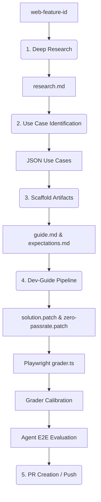

# Authoring and Testing Guides

This README details how to use the `gd` CLI to test and calibrate your guides as they progress through the 3-stage workflow.

**Prerequisite Setup:**
Before using the `gd` CLI, ensure it's linked globally:

```bash
pnpm install
pnpm link --global && gd setup-completion
```
*Note: For the auto-completion to take effect, you must refresh your shell (e.g., open a new terminal or source your config).*

### Stage 3 Pipeline: `gd dev`

Once you reach **Stage 3 (Needs evals)**—meaning `guide.md` and `expectations.md` are written—you can use `gd dev` to automatically generate all missing evaluation artifacts and calibrate the grader in one command:

```bash
gd dev <path/to/guide_dir>

# e.g. gd dev guides/performance/content-vis
```

This will automatically:
1. Inventory existing artifacts and ensure prerequisites are met.
2. Generate target base-app artifacts inside `targets/<base_app>/` for all supported base apps (e.g. `daily-grind`):
   - `solution.patch`: Patch representing the correct/guided solution implementation applied to the base app.
   - `zero-passrate.patch`: Patch representing the legacy/anti-pattern approach implementation applied to the base app.
   - `task.md`: Frontend metadata config and prompts for the agent.
   - `grader.ts`: Playwright tests based on expectations.
3. Calibrate the grader (ensures it passes 100% when the solution patch is applied, and fails 100%/scores 0% when the zero-passrate patch is applied).
4. If calibration fails, it reads the test failure logs, regenerates `grader.ts` with the failure context, and retries (up to 4 times).

Agent tests run automatically after successful calibration by default. To skip the agent E2E test, add `--no-test`:

```bash
gd dev <path/to/guide_dir> --no-test
```

To batch-process all guides that have their prerequisites written but are lacking evals:

```bash
gd dev-all
```

### Checking Status: `gd audit`

You can use `gd audit` to see exactly where every guide sits in the Kanban board pipeline:

```bash
gd audit
```

This will output a categorized table sorted into the maturity stages (`Stub`, `Incomplete`, `Needs expectations`, `Needs calibration`, `Needs test`, `Eval-ready`), along with recommended next steps.

### Manual Verification and Testing

#### Testing Grader Calibration
You can automatically verify that your grader is perfectly calibrated against the target patches by running:

```bash
gd dev <path/to/guide_dir> --test-grader

# e.g. gd dev guides/performance/content-vis --test-grader
```

If calibration fails, it will provide copy-paste links directly to the generated HTML reports so you can explore test failures in detail.

#### Manual Grader Execution
Once the grader is generated, you can run it on a specific HTML file (for debugging):

```bash
gd dev <path/to/html_file> --grade

# e.g. gd dev guides/performance/content-vis/targets/daily-grind/test-results/index.html --grade
```

On each `gd grade` run, a `grade-report` folder will be created in the same directory as the specified HTML file, and the results will be displayed in a browser window.

### Testing with an Agent

#### Automated (Recommended)
By default, `gd dev` runs a full agent evaluation after calibration:

```bash
gd dev <path/to/guide_dir>
```

This runs the following pipeline after the grader calibrates successfully:
1. **Grade the base app as-is** (pre-score) — establishes a baseline before any agent runs.
2. **Run the agent** in both `unguided` (no guide access) and `guided` (with MCP guide access) modes against the base app.
3. **Grade both outputs** and print a comparison:

```
Agent test results:
  Base app (pre):   1/9 checks passed (11%)
  Unguided:         3/9 checks passed (33%)
  Guided:           8/9 checks passed (89%)
  Guide impact:     +56% (vs unguided)
```

The agent is selected from the specified `config.ts` if it exists, otherwise it uses the default in `harness/config.ts`.
The base app is selected from the generated `targets/<base_app>/task.md` file (which defaults to `daily-grind`).

#### Manual Steps
If you need more control, you can run each step individually:

1. Configure the following settings for your run in the [harness config](../harness/config.ts):
```typescript
mcpServersToEnable: ['modern-web-guidance'],
serving: Serving.MCP,
agent: Agents.GEMINI_CLI
```
*(Note: to test the agent without any guide access, set `mcpServersToEnable` to `[]`.)*

2. Build the MCP index with the guide:
```sh
pnpm build:mcp <path/to/guide_dir>
```

3. Create a `test-app` directory in the `<guide_dir>`:
```sh
mkdir <path/to/guide_dir>/test-app/
```
Within this folder, create a base app (e.g. `index.html`) that you want the agent to modify (or, leave the folder empty for a completely blank slate).

4. Run the agent on the test app with a prompt:
```bash
gd run <path/to/guide_dir>/test-app/ "<prompt>"
```
This will create a `test-app-result` directory in the `<path/to/guide_dir>` folder with the results of the run.

5. Run the grader and see the results on the generated file:
```bash
gd dev <path/to/guide_dir>/test-app-result/index.html --grade
```

---

## Pipeline V2 Architecture

The `pipelinev2` in this repository is an automated system for generating, calibrating, and testing web platform guidance. It facilitates a multi-stage workflow that takes a web feature from initial use case identification to a fully tested and calibrated guidance package ready for evaluation.

### Workflow Comparison

```text
           Previous guidance pipeline            │        Pipeline V2
─────────────────────────────────────────────────┼──────────────────────────────────────────────────
                                                 │
 🧠 Stage 1: Identify Use Cases                  │  🤖 Deep Research & Usecase Gen
    SME reads specs, writes stubs & demo.        │     Agent crawls, determines usecases.
                                                 │
 First PR: 👥 Approve Use Cases                  │
    Team reviews selection & naming.             │
                                                 │
 🧠 Stage 2: Author Guidance                     │  🤖 Agent authors guide/expectations/demo
    SME fleshes out guide & expectations.        │
                                                 │
 🤖 Stage 3: Task & Grader Generation            │  🤖 Task & Grader Generation
    `gd dev`                                     │     `gd dev`
                                                 │
 Second PR: 👥 Final Review                      │  First PR: 🧠 SME Review
    Team reviews full package.                   │     Bot opens PR. SME reviews key files.
                                                 │
                                                 │  🤖 Feedback Iteration
                                                 │     Bot handles SME feedback automatically.
─────────────────────────────────────────────────┴──────────────────────────────────────────────────
Key: 🧠 Subject Matter Expert | 👥 Team Reviewers | 🤖 Automation/Agent
```

### Workflow Stages

#### Stage 1 & 2: Use Case Identification and Scaffolding (`guide-gen.ts`)
This stage is triggered by `gd gen-guide <feature-id>`.

1. **Feature Lookup**: Looks up the feature in the `web-features` package.
2. **Deep Research**: Checks if `features/<feature-id>/research.md` exists. If not, it automatically invokes the deep research script (using the specialized `deep-research-pro` model) to generate a comprehensive research report.
3. **Use Case Identification**: Uses Gemini to identify 1-3 distinct developer use cases for the feature, reading the deep research report primarily if available. Low-level features default to a single "Fundamental Guide" (e.g., Deep cloning complex objects) to avoid artificial duplication.
4. **Scaffolding**: For each identified use case, it scaffolds the baseline:
   - `guide.md`: Written using the `project-guides` skill, describing implementation, examples, and fallback strategies.
   - `expectations.md`: Written using the `project-evals` skill, describing what should pass, what should fail, and app-agnostic grading rules.

#### Stage 3: Calibration and Testing (`dev-guide.ts`)
This stage is triggered by `gd dev <path/to/guide_dir>` or called automatically by Stage 1/2.

1. **Inventory**: Verifies that `guide.md` and `expectations.md` exist.
2. **Artifact Generation**:
   - Generates target base app patch files (`solution.patch` and `zero-passrate.patch`) and agent prompts (`task.md`) under `targets/<base_app>/`.
   - Generates `grader.ts` (Playwright tests) under `targets/<base_app>/` using Gemini based on `expectations.md`.
3. **Calibration**:
   - Runs `grader.ts` against the base app patched with `solution.patch`. Expects 100% pass.
   - Runs `grader.ts` against the base app patched with `zero-passrate.patch`. Expects 100% fail (0% pass).
   - **Auto-Retry**: If calibration fails, it regenerates `grader.ts` with the failure context and retries (up to 4 times).
4. **Agent Testing** (Optional but default):
   - Runs the agent on a base app (e.g., `daily-grind`) in both unguided (no guide) and guided (with guide) modes.
   - Grades the outputs using `grader.ts`.
   - Compares results to assess guide impact.

### Execution Flow Detail


